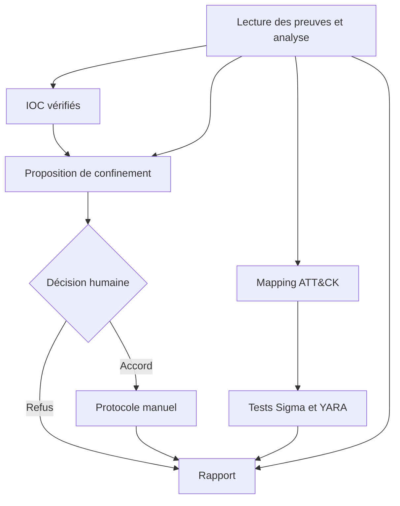

# Architecture du harness

Le modèle interprète les preuves et propose des arguments d’outils. L’hôte Python conserve l’état métier, autorise les capacités, contrôle les transitions et recueille la décision humaine.

## Composants

| Module | Responsabilité |
|---|---|
| [cli.py](../src/cyber_harness/cli.py) | Paramètres, protection des chemins, archivage et initialisation |
| [config.py](../src/cyber_harness/config.py) | Chemins du dépôt et paramètres immuables partagés par les phases |
| [workflow.py](../src/cyber_harness/workflow.py) | Construction de l’agent, phases, reprises et clôture |
| [session.py](../src/cyber_harness/session.py) | État de l’incident, dépendances, outils typés et validations |
| [models.py](../src/cyber_harness/models.py) | Contrats stricts des références, constats, IOC, mappings et protocoles |
| [evidence.py](../src/cyber_harness/evidence.py) | Lecture seule, pagination, empreintes, recherche et décodage |
| [detection/](../src/cyber_harness/detection/) | Évaluateurs déterministes et processus YARA borné |
| [mitre.py](../src/cyber_harness/mitre.py) | Mise à jour officielle et snapshot ATT&CK |
| [reporting.py](../src/cyber_harness/reporting.py) | Rapport construit depuis les résultats enregistrés |
| [runtime/](../src/cyber_harness/runtime/) | Capacités, audit, budgets, déduplication et récupération |

Les wrappers de [tools.py](../src/cyber_harness/tools.py) servent aux vérifications unitaires. L’agent reçoit les outils de `Session.stage_tools()`, associés à l’incident actif et à sa phase. Un chemin fourni par le modèle ne détermine pas la destination de stockage.

## Parcours et dépendances

Le diagramme représente les dépendances métier ; l’orchestrateur parcourt les phases dans l’ordre défini par `PHASES`. Un échec IOC bloque le confinement tout en laissant possibles le mapping et les tests. Une règle en échec conserve un verdict incomplet et n’interdit pas un confinement justifié indépendamment. Une analyse absente bloque les étapes dépendantes et déclenche une clôture de secours.

Le modèle est reconstruit pour chaque phase. L’état validé reste dans `Session`, et les livrables sont relus par `read_artifact`. L’historique des échanges est conservé pendant les corrections d’une même phase.

## Frontières de confiance

- **Preuves et ticket** : données non fiables. Une instruction dans un journal ne modifie pas les consignes de l’agent.
- **Procédures** : backend de fichiers en lecture seule, limité à `skills/`.
- **Modèle** : pas de shell, de navigateur, de délégation ni d’écriture générique. Les outils hors phase sont retirés et refusés à l’exécution.
- **Outils métier** : validation Pydantic, références et dépendances contrôlées avant enregistrement. Aucun outil d’approbation n’est exposé.
- **Hôte** : téléchargement MITRE et décision console. L’accord référence l’empreinte exacte de la proposition.
- **Protocole** : consignes manuelles ; aucune action de confinement n’est exécutée.

## Intégrité et récupération

Les références conservent le fichier, la ligne et son SHA-256. Les règles et le corpus possèdent aussi des empreintes vérifiées à la clôture. Le journal garde les relations entre appels et une chaîne de hachage. Il facilite l’investigation d’un run, sans constituer un registre signé résistant au contrôle complet de l’hôte.

Les budgets et tentatives appartiennent à l’exécution. Les relances et l’accord humain ne les réinitialisent pas. Les réponses vides peuvent être récupérées par un transport JSON strict, soumis aux mêmes validations que les appels natifs.

## Données du dépôt et données d’exécution

Le [cas pédagogique](../examples/inc_2026_0417/README.md) regroupe ses preuves et son corpus. `Session.base` désigne cette racine de cas ; les procédures et le cache MITRE sont configurés séparément.

`results/` contient les évaluations historiques immuables. `artifacts/latest/` reçoit les nouvelles sorties et `artifacts/runs/` leurs archives locales. Cette séparation permet de relancer le programme sans remplacer les éléments de la comparaison des versions.

Les validations structurelles établissent la provenance et la cohérence du parcours. Elles ne démontrent pas automatiquement qu’une citation soutient toute une conclusion, qu’un mapping est pertinent ou qu’une règle sera spécifique en production. Ces limites sont conservées dans la [comparaison](comparaison_versions.md) et le [retour d’expérience](retour_experience.md).
