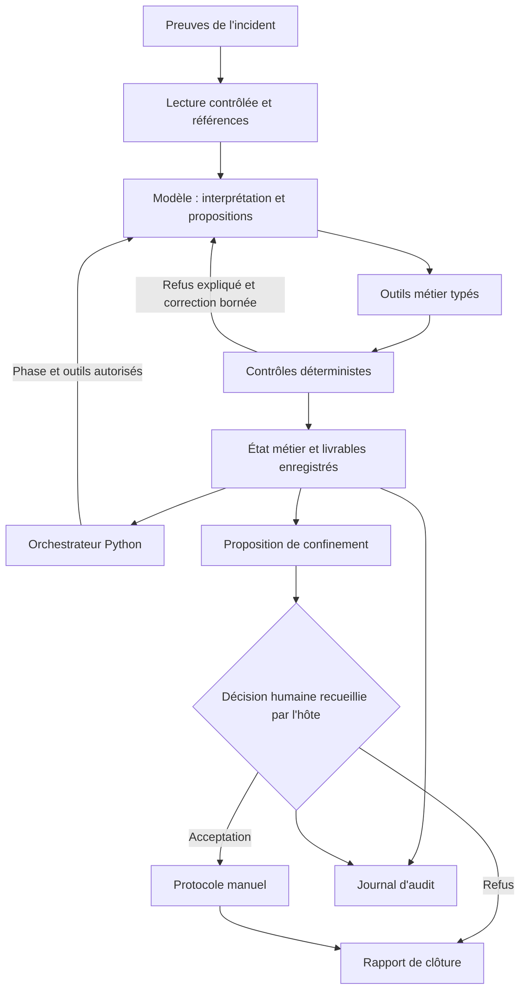

**Retour d’expérience : concevoir un harness pour un agent d’analyse d’incident cyber**

Henri DARGENT et Luka GENOT — ESILV, Security Use Cases, groupe 2  
5 novembre 2026

Nous avons développé un agent chargé d’étudier un incident de cybersécurité à partir de preuves fournies. Il devait comprendre les événements, extraire des indicateurs de compromission avec leurs sources, associer les comportements à MITRE ATT&CK, produire une règle YARA et une règle Sigma testées, puis proposer un confinement soumis à une validation humaine.

Le cas étudié, INC-2026-0417, réunit deux alertes : une activité d’injection SQL et d’export de données sur un serveur web, puis l’exécution d’une pièce jointe PowerShell sur un poste comptable. Les preuves comprennent un ticket, des journaux web et applicatifs, des événements EDR et une copie du script. Leur analyse contient plusieurs pièges : des fuseaux horaires différents, des fonctions malveillantes commentées, une connexion bloquée et une instruction hostile dissimulée dans un User-Agent.

L’enseignement principal de ce projet est que la fiabilité dépend autant de l’environnement d’exécution que du modèle. Notre première approche produisait un rapport convaincant, avec des erreurs importantes. Les améliorations les plus utiles ont consisté à rendre les étapes vérifiables et à confier au code les décisions de progression, les contrôles et la collecte de l’accord humain.

Ce retour d’expérience s’appuie sur le code actuel, les tests présents et les sorties successives `V1 — Prototype`, `V2 — Agent outillé`, `V3 — Harness structuré`, `V4 — Validation des détections` et `V5 — Validation humaine`. Ces noms désignent ici les itérations observées ; ils ne permettent pas, à eux seuls, de reconstituer un historique exact de versions du code. Nous distinguons donc les progrès visibles dans les sorties des mécanismes de correction présents dans l’implémentation actuelle. La [comparaison détaillée des sorties](comparaison_versions.md) rassemble les vérifications qui fondent cette analyse.

**L’architecture retenue et les raisons de ce choix**

Nous appelons « harness » l’ensemble qui encadre le modèle : accès aux données, outils autorisés, état de l’analyse, validations, gestion des erreurs, limites d’exécution et intervention humaine. Le modèle propose une interprétation et des arguments d’outils ; l’hôte Python vérifie ces demandes et conserve l’état métier.

L’architecture actuelle utilise DeepAgents, avec les composants LangChain et LangGraph sous-jacents, et un modèle accessible par Ollama. Le modèle par défaut du harness est `gemma4:31b-cloud`, remplaçable par configuration. Ollama constitue l’interface d’accès au modèle ; ce choix ne signifie pas que le traitement est nécessairement local, puisque le modèle configuré par défaut est un modèle cloud.

Nous avons retenu cette base pour disposer d’une boucle d’appels d’outils, de procédures accessibles au modèle et d’une instrumentation des échanges, tout en gardant la maîtrise de la logique métier dans notre code. Le modèle peut ainsi évoluer sans réécrire les contrôles de preuve ou d’approbation. Nous n’avons toutefois pas réalisé de comparaison expérimentale suffisante pour affirmer que ce modèle ou cette pile technique serait optimal pour tous les incidents.

Le parcours est séquentiel. Un agent est construit pour la phase en cours, avec les seuls outils nécessaires à cette phase. Les sous-agents et la délégation sont désactivés. Ce choix réduit le nombre de chemins d’exécution à contrôler et facilite l’explication d’une décision. Pour notre périmètre, il était plus utile de comprendre pourquoi une étape échouait que de multiplier les analyses concurrentes. La contrepartie est une latence accrue et une moindre souplesse pour revenir sur un constat ancien.

Ce schéma représente les responsabilités. Le modèle ne peut ni enregistrer lui-même une approbation ni exécuter les actions décrites dans le protocole.

La répartition dans le code est la suivante :

| Composant | Responsabilité | Intérêt du choix |
|---|---|---|
| [cli.py](../src/cyber_harness/cli.py) et [config.py](../src/cyber_harness/config.py) | Configurer les ressources, protéger les chemins et initialiser une exécution | Séparer le lancement du workflow et préserver les résultats historiques |
| [workflow.py](../src/cyber_harness/workflow.py) | Construire l’agent de chaque phase, orchestrer le parcours, recueillir la décision et clôturer le run | Garder les transitions sous le contrôle de l’hôte |
| [session.py](../src/cyber_harness/session.py) | Porter la session, les prérequis, les outils métier et la validation finale | Vérifier les résultats réellement enregistrés avant de progresser |
| [models.py](../src/cyber_harness/models.py) | Définir les contrats Pydantic des constats, références, IOC, propositions et protocoles | Refuser les arguments incomplets ou les champs inattendus |
| [evidence.py](../src/cyber_harness/evidence.py) | Lire les preuves, suivre les lignes consultées, calculer les empreintes et décoder statiquement | Conserver une provenance contrôlable sans exécuter les échantillons |
| [boundaries.py](../src/cyber_harness/runtime/boundaries.py) | Limiter les capacités et l’accès générique aux fichiers | Réserver cet accès aux procédures en lecture seule |
| [detection/](../src/cyber_harness/detection/), [yara_worker.py](../src/cyber_harness/detection/yara_worker.py) et [mitre.py](../src/cyber_harness/mitre.py) | Tester les règles et consulter un référentiel officiel figé pendant le run | Produire des résultats vérifiables indépendamment du récit du modèle |
| [reporting.py](../src/cyber_harness/reporting.py) | Assembler le rapport depuis les états et résultats enregistrés | Séparer la présentation des contrôles métier |
| [feedback.py](../src/cyber_harness/runtime/feedback.py), [control.py](../src/cyber_harness/runtime/control.py) et [diagnostics.py](../src/cyber_harness/runtime/diagnostics.py) | Expliquer les refus, borner les corrections et diagnostiquer les réponses inexploitables | Permettre une récupération sans boucle illimitée |
| [audit.py](../src/cyber_harness/runtime/audit.py) | Journaliser les appels, résultats, erreurs, livrables et décisions | Reconstituer les raisons d’une réussite ou d’un échec |

**Un parcours organisé autour de livrables vérifiables**

Les sept phases sont : preuves, IOC, ATT&CK, règles, confinement, protocole et rapport. Elles s’appuient sur six procédures dans `skills/`, la procédure de confinement couvrant aussi le protocole. Les procédures expliquent la méthode au modèle ; les outils imposent les contraintes à l’exécution.

Nous avons choisi de produire d’abord une analyse structurée. Chaque constat possède un identifiant, une description, des références et un statut parmi `observe`, `tentative_bloquee`, `present_dans_script` et `hypothese`. Les IOC et les associations ATT&CK réutilisent ensuite ces identifiants. Cela permet de suivre le raisonnement depuis une preuve jusqu’à la proposition de confinement.

Une référence contient le fichier, la ligne à partir de 1 et le SHA-256 du fichier source. Le harness vérifie son existence et son empreinte. Il suit également la couverture de lecture : consulter la dernière page d’un fichier ne suffit pas à déclarer toutes ses lignes lues. Pour les IOC encodés, le décodage conserve la ligne d’origine et la transformation appliquée.

Nous avons conservé des dépendances sélectives entre les phases. Une extraction IOC en échec bloque le confinement, mais laisse possibles le mapping des comportements et les tests de détection. De même, une règle YARA en échec n’empêche pas de proposer un confinement justifié par des constats et des IOC vérifiés ; elle maintient cependant le bilan global incomplet. Cette organisation préserve le travail utile sans masquer les étapes manquantes.

Le référentiel ATT&CK est actualisé par l’hôte, puis figé pour la session. Le modèle recherche et vérifie les techniques dans ce snapshot. Il n’a pas à reconstruire les noms et statuts depuis sa mémoire. L’empreinte et la version utilisées sont conservées pour expliquer ultérieurement le mapping.

Nous avons aussi retiré les capacités inutiles au cas d’usage : aucun shell, aucune navigation réseau ni écriture arbitraire n’est exposé au modèle. Les preuves passent par les outils de lecture et les livrables par les outils métier. Cette restriction est particulièrement utile face à la tentative d’injection de prompt présente dans `web_access.log:7`. Le texte des preuves reste une donnée à interpréter, y compris lorsqu’il prétend donner des instructions à l’assistant.

Enfin, la décision humaine est recueillie dans la console de l’hôte après présentation de la proposition. Une acceptation autorise uniquement la rédaction du protocole manuel. Un refus mène au rapport, sans nouvelle proposition ni protocole. La décision conserve l’empreinte de la proposition concernée ; le protocole doit reprendre ses actions et ses cibles. Cette séparation rend le périmètre approuvé identifiable.

**Les versions successives : d’un rapport libre à une analyse contrôlée**

Le prototype conservé dans [agent_baseline.py](../examples/agent_baseline.py) illustre notre point de départ : un modèle, un accès aux fichiers du projet et un prompt minimal, « Tu es un analyste SOC ». Cette approche était rapide à mettre en place et permettait d’observer les capacités spontanées du modèle. Elle ne fournissait cependant pas de contrôle métier suffisant pour distinguer une analyse correcte d’un texte plausible.

| Itération observée | Évolution visible | Enseignement tiré |
|---|---|---|
| `V1 — Prototype` | Rapport libre avec des événements réels, mais lien entre attaques inventé, erreurs ATT&CK et règles invalides | Un rapport bien rédigé ne suffit pas à établir sa fiabilité |
| `V2 — Agent outillé` | Livrables séparés, références partielles, YARA exploitable et statuts de confinement consignés | Ajouter des outils ne garantit ni leur usage correct ni la cohérence entre les fichiers |
| `V3 — Harness structuré` | Constats identifiés, chronologie UTC, statuts explicites, contrôles de provenance et bilan incomplet | L’échec devient explicite : IOC et YARA échouent, confinement bloqué |
| `V4 — Validation des détections` | Meilleurs choix ATT&CK, deux règles réussissant le corpus local, décodage Base64 sourcé | Les corrections améliorent la détection, mais l’enregistrement des IOC reste fragile |
| `V5 — Validation humaine` | IOC enregistrés, décision humaine distincte, protocole et parcours déclaré complet | La chaîne est plus aboutie ; le sens des conclusions et des actions demande encore une relecture |

Le passage à `V3 — Harness structuré` constitue un changement important dans notre manière d’évaluer le résultat. Les versions précédentes pouvaient annoncer une tâche accomplie sans livrable valide. Le harness signale désormais une analyse incomplète et conserve ce qui a pu être produit. Cette sortie est moins rassurante en apparence, mais elle donne à l’analyste une représentation plus fidèle de la situation.

L’amélioration n’a pas été linéaire. Dans `V4 — Validation des détections`, un décodage révèle l’URL `http://192.168.1.100/stage.ps`, différente de `stage1.ps1` présente en clair. La dernière sortie n’exploite plus cette information. Elle enregistre ses IOC avec succès, mais omet notamment le domaine observé en DNS et le hash du script. Nous avons donc appris à examiner simultanément la conformité des éléments conservés et la couverture des éléments importants.

Les corrections actuelles comprennent aussi des ajustements issus des traces de développement : prise en charge explicite de la pagination, déduplication des lectures identiques d’un même lot, retours d’erreur plus précis et récupération des réponses modèle vides. Des appels capturés ont été conservés dans `tests/fixtures/` pour rendre ces problèmes reproductibles, sans relancer le modèle cloud.

**Première erreur majeure : transformer des indices en une histoire d’attaque certaine**

Dans la première sortie, l’agent affirme que `203.0.113.42` est à l’origine des deux attaques et aurait envoyé le courriel malveillant. Cette adresse apparaît dans les journaux du serveur web, mais ni dans les événements EDR ni dans le script. Aucun en-tête de courriel fourni ne permet d’établir cette attribution. La proximité temporelle a été transformée en preuve de coordination.

L’erreur concernait aussi le statut des actions. Le script contient du code de persistance, de keylogging et d’exfiltration dans des blocs commentés. Les premières réponses traitaient certains de ces comportements comme des actions réalisées. De la même façon, une requête WMI sur l’antivirus peut être confondue avec une désactivation de l’antivirus, alors qu’elle montre une recherche d’information.

La cause identifiable dans notre architecture initiale était l’absence de contrat de preuve. Le modèle devait produire directement un récit global, sans être obligé de séparer chaque constat, son origine et son niveau de certitude. Le prompt minimal ne structurait pas cette distinction. Les erreurs de noms ATT&CK relevaient du même problème : les connaissances du modèle tenaient lieu de référentiel.

Nous avons répondu à cette difficulté en ajoutant des constats structurés et sourcés, des statuts explicites, une conversion UTC contrôlée et l’obligation de fournir des preuves pour déclarer un lien entre alertes. Le mapping ATT&CK exige maintenant une vérification préalable de chaque identifiant et refuse les techniques révoquées ou obsolètes. Les noms et descriptions officiels sont repris dans le livrable.

Le résultat est visible : les trois dernières sorties cessent de confirmer un lien technique entre les alertes et distinguent la tentative réseau bloquée des capacités du script. La correction reste partielle. Une référence valide peut soutenir seulement une partie d’une phrase, et les dernières synthèses présentent encore certaines relations causales trop fortement. Le harness réduit les possibilités d’hallucination et les rend plus visibles ; il ne prouve pas automatiquement que toute interprétation est juste.

**Deuxième erreur majeure : déclarer des règles valides sans démontrer leur fonctionnement**

Les premières règles illustraient l’écart entre une proposition vraisemblable et une détection utilisable. La Sigma initiale avait un identifiant non conforme et une logique de sélection incorrecte. La YARA initiale ne respectait pas la syntaxe du langage et exigeait un en-tête `MZ` d’exécutable alors que l’échantillon était un script texte. La version suivante annonçait encore une validation Sigma malgré une condition placée au mauvais niveau.

Le problème venait de la responsabilité laissée au modèle : il pouvait écrire la règle, commenter son fonctionnement et annoncer lui-même sa réussite. Une mention `status: test` ou une phrase affirmant la compilation ne constitue pourtant pas un résultat de test. Il manquait une vérification externe conditionnant l’acceptation du livrable.

Nous avons donc intégré la compilation et l’évaluation dans les outils. Sigma est analysée avec pySigma, puis évaluée sur les événements pris en charge. YARA est compilée et appliquée aux octets des échantillons dans un processus séparé, avec inclusions externes désactivées et limites de temps. Les scripts analysés ne sont jamais exécutés. Le corpus distingue explicitement les exemples positifs et négatifs.

Chaque essai conserve le résultat, l’empreinte de la règle et celle du corpus. Une règle modifiée après son test invalide la validation finale. Le nombre d’essais est limité à quatre par moteur. Le rapport est assemblé par l’hôte à partir de ces résultats, ce qui empêche une simple affirmation du modèle de remplacer un échec enregistré.

Cette correction a permis de déclarer honnêtement l’échec YARA dans `V3 — Harness structuré`, puis de constater la réussite locale des deux règles dans `V4 — Validation des détections` et `V5 — Validation humaine`. Nous avons ainsi résolu le problème de la validation annoncée sans preuve. La qualité générale des règles reste ouverte : la YARA finale utilise `any of them` et détecte même le texte bénin `Write-Host "ToUnicode"`. La Sigma finale accepte Bypass ou Hidden, alors que sa description peut laisser attendre les deux options. Le [contrôle complémentaire des règles](comparaison_verifications.json) montre ces limites ; son environnement de revalidation et les différences de versions sont précisés dans la comparaison détaillée.

Cette expérience nous a appris à distinguer trois questions : la règle est-elle syntaxiquement valide, détecte-t-elle les événements attendus et reste-t-elle suffisamment spécifique sur des données proches mais légitimes ? Le corpus actuel répond surtout aux deux premières sur notre cas d’étude.

**Troisième erreur majeure : bloquer le parcours sur des erreurs d’interface difficiles à corriger**

Dans `V3 — Harness structuré` et `V4 — Validation des détections`, l’agent trouve des IOC pertinents et appelle les vérifications, mais échoue à les enregistrer. Le harness exige toutes les occurrences exactes renvoyées par l’outil. Les lots proposés en omettent certaines et sont refusés trois fois, ce qui bloque le confinement. Dans un lot de `V4 — Validation des détections`, il manque notamment `facture_2024-11.ps1.txt:144` pour `192.168.1.100`, ainsi que plusieurs occurrences de `admin`.

Les indicateurs n’étaient donc pas tous faux. Le problème venait aussi de l’interface : le modèle devait recopier des listes de références longues et recevait un message générique lui demandant de conserver toutes les occurrences. Il pouvait corriger une valeur tout en laissant une autre invalide, puis répéter une proposition incomplète. Un contrôle strict, sans retour suffisamment précis, produisait un blocage difficile à résoudre.

Nous avons enrichi les erreurs métier. Le code actuel examine tout le lot avant d’écrire et indique, pour chaque valeur concernée, le champ en erreur, les références manquantes ou inattendues et, si nécessaire, l’appel de vérification à effectuer. Les erreurs de schéma répétées sont regroupées. Le retour rappelle également les identifiants de constats et les livrables réellement disponibles. Le harness ne fabrique pas de références pour faire passer l’appel.

Nous avons aussi corrigé les interfaces de lecture. Des traces montraient des demandes utilisant `offset` qui ne produisaient pas la progression attendue. Le contrat actuel accepte explicitement `debut` à partir de 1 ou `offset` à partir de 0, refuse leur combinaison et signale les paramètres inconnus. Chaque page indique les portions restant à lire. Cela évite qu’une erreur de pagination se transforme en boucle ou en analyse prématurée.

Un autre symptôme était la réception de réponses sans texte ni appel d’outil exploitable. Nous avons ajouté un diagnostic distinguant autant que possible réponse fournisseur vide, raisonnement seul, appel mal formé et perte de conversion. La récupération désactive d’abord le streaming et la demande de raisonnement, puis peut demander une enveloppe JSON texte limitée aux outils d’enregistrement de la phase. Cette enveloppe repasse par les validations habituelles ; elle ne permet ni d’approuver une action ni de contourner un refus métier.

Ces corrections sont bornées : trois appels invalides au même outil arrêtent la phase, et une phase terminée trop tôt bénéficie au plus de deux relances avec son historique. Le budget global, de 200 appels modèle par défaut, ne repart pas à zéro. Une réserve permet de produire un rapport même après un arrêt. Les lectures identiques émises dans un même lot sont dédupliquées, tandis que les écritures et les décisions ne le sont pas.

La dernière sortie enregistre effectivement ses IOC et atteint l’accord humain. Les tests de récupération rejouent également un appel IOC incomplet capturé, vérifient que le retour fournit les références exactes à ajouter et couvrent un parcours corrigé jusqu’au rapport. Cela démontre le fonctionnement du mécanisme de correction sur ces cas contrôlés. Cela ne prouve pas que tous les futurs modèles sauront utiliser ce retour, ni que la couverture des IOC sera suffisante.

**Comment nous avons vérifié les améliorations**

Nous avons utilisé deux niveaux de vérification complémentaires. L’examen des sorties réelles permet de juger la compréhension, les omissions et la pertinence opérationnelle. Les tests déterministes utilisent des faux modèles et des répertoires temporaires pour vérifier les contrats, les refus, les budgets, les récupérations et les parcours d’acceptation ou de refus humain.

Les tests présents couvrent notamment les références hors limites, les mauvaises empreintes, les lectures incomplètes, les chemins interdits, les outils non autorisés, les techniques ATT&CK révoquées, les règles modifiées après test, les réponses vides et les approbations forgées. Plusieurs fixtures proviennent d’appels capturés dans des traces. Conserver ces cas nous permet de vérifier qu’une correction d’ergonomie ne supprime pas un contrôle nécessaire.

Le journal local complète ce dispositif. Il conserve les appels, erreurs, états de phase, empreintes et décisions, avec un chaînage SHA-256. LangSmith peut ajouter une observation distante, mais reste facultatif. Cette trace nous a permis de distinguer une valeur IOC inventée d’une valeur correcte mal enregistrée, ou une erreur d’analyse d’un problème de transport du modèle.

Ces vérifications ne constituent pas une mesure générale de performance. Les cinq sorties correspondent à un même incident, avec des conditions qui ne sont pas entièrement figées entre toutes les itérations. Le modèle et le référentiel peuvent évoluer. Nous pouvons décrire des progrès et des régressions observés, sans en déduire un taux global d’hallucination ou une fiabilité de production.

**Les limites actuelles du harness**

La principale limite est sémantique. Le code sait vérifier qu’une référence existe, qu’un IOC y apparaît et qu’une technique ATT&CK est officielle. Il vérifie beaucoup moins bien que la preuve soutient toute l’affirmation. Une authentification réussie après plusieurs échecs ne démontre pas, à elle seule, comment le mot de passe a été obtenu. Un export important ne prouve pas son automatisation. De même, la copie du script contient un bypass AMSI hors des blocs commentés malgré une bannière annonçant les fonctions dangereuses désactivées : comprendre cette contradiction exige encore une lecture attentive.

La complétude du parcours reste distincte de celle de l’enquête. La sortie finale omet des IOC utiles et plusieurs événements directement journalisés. Le harness contrôle les valeurs soumises, mais ne dispose pas encore d’un contrôle suffisant des informations importantes que le modèle n’a pas extraites. L’obligation de recopier toutes les occurrences crée aussi du bruit et une charge de correction sans toujours améliorer la justification du caractère malveillant.

Le confinement reste imparfait sur le fond. Dans `V5 — Validation humaine`, l’action d’isolation du poste porte un nom de fichier comme cible structurée, alors que l’EDR indique que le poste est déjà isolé. Son impact attendu promet aussi l’arrêt du script et de la persistance, qu’une isolation réseau seule ne garantit pas. Le protocole reprend un retour arrière consistant à restaurer l’ancien mot de passe d’un compte considéré compromis. Les contrôles actuels préservent l’identité de la proposition approuvée, sans certifier la pertinence de chaque consigne.

Le périmètre technique est limité. Le scénario et plusieurs contrats sont adaptés aux deux alertes du TD. Les preuves sont textuelles et chargées en mémoire ; le modèle doit les consulter intégralement. Cela ne convient pas directement à des millions d’événements. L’évaluateur Sigma ne couvre qu’un sous-ensemble de `windows/process_creation`, et le corpus YARA comporte un seul positif et six scripts bénins. Le processus YARA séparé est borné, mais ne constitue pas une machine virtuelle de sécurité.

L’exploitation reste celle d’un prototype local : état actif principalement en mémoire, sorties dans un répertoire commun, décision via une console et absence de reprise durable complète après incident de service. Le chaînage d’audit ne protège pas contre un administrateur capable de réécrire tout le journal. Le masquage de certains secrets n’équivaut pas à une anonymisation des preuves. L’usage d’un modèle cloud ou d’une trace distante demande donc un choix explicite sur les données transmises.

Enfin, les restrictions d’outils limitent les conséquences possibles d’une injection de prompt, mais elles ne garantissent pas l’intégrité de l’interprétation. Une instruction hostile peut chercher à influencer une qualification sans demander de shell ni d’écriture interdite. Le maintien de l’IP malveillante et le signalement de l’injection dans ce cas précis ne suffisent pas à démontrer une résistance générale.

**Les évolutions à prévoir pour un usage en production**

Une trajectoire réaliste commencerait par un assistant d’investigation utilisé par des analystes, avec collecte en lecture seule et validation des livrables. L’intégration opérationnelle pourrait ensuite être élargie selon des critères mesurables, en conservant une séparation entre analyse, approbation et éventuelle exécution.

| Priorité | Évolution proposée | Résultat attendu |
|---|---|---|
| 1 — Qualité des conclusions | Constats plus atomiques, séparation explicite des faits et interprétations, revue des citations et contrôle des contradictions | Réduire les conclusions qui dépassent leurs preuves |
| 1 — Couverture de l’enquête | Extraction déterministe de candidats IOC, références conservées côté code, distinction entre observation, déclaration dans le script et dérivation | Limiter les omissions sans déléguer la copie des occurrences au modèle |
| 1 — Pertinence des règles | Corpus variés, négatifs proches, cas avec une ou deux options, refus des doublons YAML et jeux de validation séparés | Détecter les conditions trop larges et l’ajustement au seul échantillon |
| 1 — Confinement | Types d’actions et de cibles, périmètre du compte, état déjà connu, impacts et retours arrière contrôlés | Refuser notamment une isolation dont la cible est un fichier |
| 2 — Ingestion | Connecteurs SIEM, EDR et messagerie en lecture seule, formats normalisés et provenance immuable | Étendre l’analyse au-delà des fichiers du TD |
| 2 — Robustesse de service | Stockage d’état persistant, espace isolé par incident, reprise contrôlée, quotas et gestion explicite des pannes | Supporter plusieurs analyses et les interruptions de service |
| 2 — Protection des données | Identités et droits par rôle, séparation des incidents, chiffrement, rétention maîtrisée et journal externe protégé | Protéger les preuves et attribuer les décisions à des utilisateurs authentifiés |
| 3 — Déploiement des détections | Conversion vers le backend SIEM cible, validation sur sa télémétrie puis observation sans action automatique | Vérifier le comportement dans l’environnement réel |
| 3 — Réponse assistée | Service d’exécution distinct, actions autorisées et typées, accord lié aux paramètres, contrôles avant et après action | Étendre la réponse en conservant des responsabilités identifiables |

Pour les gros volumes, nous pourrions normaliser et indexer les événements, puis fournir au modèle les éléments pertinents avec leurs sources exactes. Il faudrait alors mesurer la couverture de cette sélection : une erreur de recherche documentaire peut produire une conclusion erronée même si le modèle interprète correctement les extraits reçus. Le passage à l’échelle doit donc préserver une traçabilité des données examinées et écartées.

L’évaluation devrait reposer sur plusieurs incidents annotés par des analystes et sur des exécutions répétées, en enregistrant les versions du code, les modèles, les prompts, les dépendances et les snapshots. Les indicateurs utiles seraient la précision et le rappel des IOC, la justesse des citations, les comportements ATT&CK correctement associés, les faux positifs des règles, la pertinence des actions et la récupération après erreur. La durée, le coût et le taux de parcours complets resteraient des mesures complémentaires.

Nous séparerions aussi les verdicts présentés à l’utilisateur : intégrité des preuves, conformité des livrables, réussite des tests, couverture de l’analyse et validation humaine du contenu. Cette présentation éviterait qu’un statut global « complet » donne une confiance excessive dans une interprétation encore discutable.

Une éventuelle exécution de confinement demanderait une architecture supplémentaire. L’accord devrait désigner une action et des paramètres exacts, avec un utilisateur authentifié, une durée de validité et une nouvelle vérification du contexte avant exécution. Un service distinct appliquerait les commandes autorisées, vérifierait leur effet et tracerait les échecs. Cette capacité n’existe pas dans notre prototype actuel, qui produit exclusivement des consignes manuelles.

Ce projet nous a conduits à déplacer progressivement la responsabilité de la fiabilité vers des contrats, des preuves et des contrôles observables. Nous disposons désormais d’une base capable de rendre un échec explicite, de conserver la provenance et de soumettre une proposition à un humain. L’étape suivante consiste à renforcer la compréhension et la couverture de l’enquête, puis à démontrer ces qualités sur des données et des conditions d’exploitation plus variées.

**Documents et éléments de référence du projet**

- [README et fonctionnement du harness](../README.md).
- [Comparaison qualitative des cinq sorties](comparaison_versions.md) et [vérifications complémentaires des règles](comparaison_verifications.json).
- [Ticket et périmètre du cas étudié](../examples/inc_2026_0417/incident/ticket_INC-2026-0417.md).
- [Rapport initial](../results/v1_prototype/rapport_incident.md), [première sortie enrichie](../results/v2_agent_outille/rapport_incident.md), [V3 — Harness structuré](../results/v3_harness_structure/rapport_incident.md), [V4 — Validation des détections](../results/v4_validation_detection/rapport_incident.md) et [dernier rapport](../results/v5_validation_humaine/rapport_incident.md).
- [Tests de récupération des phases et des IOC](../tests/test_phase_recovery.py), [de pagination](../tests/test_evidence_pagination.py), [du transport modèle](../tests/test_model_diagnostics.py) et [du confinement](../tests/test_containment_recovery.py).
